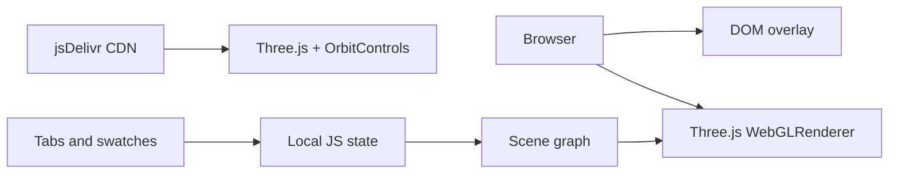

# System Architecture

## Runtime model

The application is a browser-only single page. HTML/CSS provides the overlay; JavaScript owns local state and the Three.js scene; WebGL renders the scene continuously.

## Layers

- Presentation: semantic HTML and inline CSS.
- Interaction/state: `activeProduct`, `activeColor`, idle timer, DOM event listeners.
- Scene: lights, floor, stage group, product groups, camera, controls.
- External runtime: Three.js and OrbitControls from jsDelivr.

## Important constraints

There is no server, persistent data, API, database, authentication, or authorization layer in the repository.
