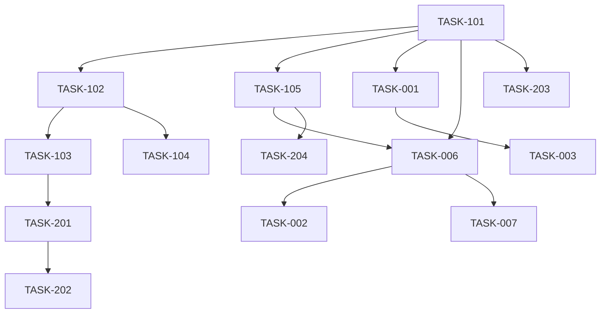

# Forma — Development Task Board

This is the primary development management interface. Every task is described here in full; linked task files contain deeper implementation notes. Do not mark a task `DONE` without evidence.

## 1. Project Overview

Forma is a browser-only, zero-build Three.js r169 WebGL product showcase. The current application is implemented in `index.html` and contains procedural speaker, headphones, and smartwatch products, OrbitControls interaction, material color switching, responsive DOM UI, and a mailto CTA.

Current phase: prototype hardening before production readiness.

## 2. Task Statistics

| Status | Count |
|---|---:|
| DONE | 7 |
| TODO | 7 |
| IN_PROGRESS | 0 |
| BLOCKED | 0 |
| IN_REVIEW | 0 |
| TESTING | 2 |
| CANCELLED | 0 |
| **Total** | **16** |

## 3. Priority Summary

- **P0 / Critical:** 2 — TASK-001, TASK-002
- **P1 / High:** 13 — TASK-003, TASK-004, TASK-006, TASK-007, TASK-101–TASK-105, TASK-201, TASK-203–TASK-205
- **P2 / Medium:** 1 — TASK-202
- **P3 / Low:** 0

## 4. Milestone Overview

| Milestone | Objective | Progress | Status | Tasks |
|---|---|---:|---|---|
| MILESTONE-001 | Core WebGL showcase foundation | 100% | DONE | TASK-101–TASK-105 |
| MILESTONE-002 | Runtime reliability and mobile quality | 20% | IN_PROGRESS | TASK-001, TASK-002, TASK-003, TASK-006, TASK-007 |
| MILESTONE-003 | Premium camera motion and export | 0% | TODO | TASK-201, TASK-202 |
| MILESTONE-004 | Resource lifecycle and accessibility hardening | 0% | TODO | TASK-203, TASK-204 |
| MILESTONE-005 | Release and documentation operations | 100% | DONE | TASK-004, TASK-205 |

## 5. Current Priorities

1. **TASK-006** — establish real mobile performance evidence.
2. **TASK-006** — complete browser/device performance measurements.

Eligible now: `TASK-006` after its current TESTING evidence is completed.

## 6. Development Task Registry

### MILESTONE-001 — Core Foundation

### TASK-101 — Initialize Three.js Scene

- **Description:** Create and maintain the browser WebGL scene foundation: scene, perspective camera, renderer, studio lights, floor, and animation loop.
- **Priority:** High (P1).
- **Status:** DONE.
- **Dependencies:** None.
- **Acceptance Criteria:**
  - Three.js scene, camera, renderer, lighting, floor, and render loop exist in the application.
  - The renderer uses the verified WebGL configuration in `index.html`.
  - Source evidence is present at `index.html:106-137` and `index.html:266-275`.
- **Progress:** 100%.
- **Related Docs:** [Task detail](tasks/MILESTONE-001/TASK-101.md), [System Architecture](../architecture/SYSTEM_ARCHITECTURE.md), [Tech Stack](../architecture/TECH_STACK.md).
- **Notes:** Implemented. Browser execution evidence remains manual because no browser test harness exists.

### TASK-102 — Build Procedural Product Collection

- **Description:** Build and register the speaker, headphones, and smartwatch as procedural Three.js product groups without local 3D model assets.
- **Priority:** High (P1).
- **Status:** DONE.
- **Dependencies:** TASK-101.
- **Acceptance Criteria:**
  - Three product groups are created from procedural geometry.
  - Product groups are registered under one collection and can be shown or hidden.
  - Source evidence is present at `index.html:153-215`.
- **Progress:** 100%.
- **Related Docs:** [Task detail](tasks/MILESTONE-001/TASK-102.md), [Modules](../architecture/MODULES.md), [Web3D Audit](../audit/WEB3D_AUDIT.md).
- **Notes:** Implemented. GLTF/GLB and texture pipelines are explicitly out of scope.

### TASK-103 — Product Switching and UI Synchronization

- **Description:** Synchronize product visibility, category, title, description, specs, CTA label, camera target, and pressed tab state when a product changes.
- **Priority:** High (P1).
- **Status:** DONE.
- **Dependencies:** TASK-102.
- **Acceptance Criteria:**
  - Selecting each product shows exactly the selected product group.
  - Product copy, specs, CTA label, and `aria-pressed` state update together.
  - Source evidence is present at `index.html:235-250`.
- **Progress:** 100%.
- **Related Docs:** [Task detail](tasks/MILESTONE-001/TASK-103.md), [Requirements](../product/REQUIREMENTS.md), [UX Flows](../design/UX_FLOWS.md).
- **Notes:** Implemented. Camera target currently snaps; smooth tweening is TASK-201.

### TASK-104 — Color Customization

- **Description:** Apply Sand, Slate, and Rose palette values to the active product's color materials and synchronize swatch state.
- **Priority:** High (P1).
- **Status:** DONE.
- **Dependencies:** TASK-102.
- **Acceptance Criteria:**
  - Each swatch changes the active product's intended color material.
  - Only the active product's color materials are updated.
  - Swatches expose the correct `aria-pressed` state after every selection.
- **Progress:** 100%.
- **Related Docs:** [Task detail](tasks/MILESTONE-001/TASK-104.md), [Feature Specifications](../product/FEATURE_SPECIFICATIONS.md), [Design System](../design/DESIGN_SYSTEM.md).
- **Notes:** Implemented. Texture-based color variation is not present.

### TASK-105 — Orbit Interaction and Auto-Rotation

- **Description:** Provide OrbitControls camera exploration with damping, zoom/polar limits, pan, interaction pause, cooldown, and idle product rotation.
- **Priority:** High (P1).
- **Status:** DONE.
- **Dependencies:** TASK-101.
- **Acceptance Criteria:**
  - Drag, zoom, and pan respond through OrbitControls.
  - Camera distance and polar angle remain within configured limits.
  - Auto-rotation pauses during interaction and resumes after cooldown.
- **Progress:** 100%.
- **Related Docs:** [Task detail](tasks/MILESTONE-001/TASK-105.md), [User Flows](../design/UX_FLOWS.md), [Legacy User Flow](../USER_FLOW.md).
- **Notes:** Implemented. JavaScript reduced-motion support is TASK-204.

### MILESTONE-002 — Runtime Reliability and Mobile Quality

### TASK-001 — Add WebGL and Module Fallback

- **Description:** Add visible, accessible fallback handling for WebGL initialization failure and Three.js/CDN module loading failure.
- **Priority:** Critical (P0).
- **Status:** TESTING.
- **Dependencies:** TASK-101.
- **Acceptance Criteria:**
  - WebGL unavailable produces an understandable fallback instead of a blank page.
  - Module/CDN failure produces actionable guidance.
  - Normal successful initialization and existing DOM product information remain usable.
- **Progress:** 80%.
- **Related Docs:** [Task detail](tasks/MILESTONE-002/TASK-001.md), [Error Handling](../engineering/ERROR_HANDLING.md), [Security Audit](../security/SECURITY_AUDIT.md).
- **Notes:** Implemented fallback UI, module failure handlers, and WebGL initialization guard. Browser verification remains pending; do not mark DONE yet.

### TASK-002 — Define Mobile Performance Budget

- **Description:** Convert measured mobile rendering behavior into explicit FPS, frame-time, draw-call, DPR, and visual-quality guardrails.
- **Priority:** Critical (P0).
- **Status:** DONE.
- **Dependencies:** TASK-006.
- **Acceptance Criteria:**
  - A budget is documented for at least one low-tier mobile profile.
  - A desktop comparison and quality trade-offs are recorded.
  - Every target is traceable to TASK-006 measurements rather than guesses.
- **Progress:** 100%.
- **Related Docs:** [Task detail](tasks/MILESTONE-002/TASK-002.md), [Performance Audit](../audit/PERFORMANCE_AUDIT.md), [Web3D Audit](../audit/WEB3D_AUDIT.md).
- **Notes:** This task defines guardrails; TASK-007 implements adaptive tuning.

### TASK-003 — Add Browser Smoke Tests

- **Description:** Introduce reproducible browser smoke tests for initial load, product switching, color switching, resizing, and CTA behavior.
- **Priority:** High (P1).
- **Status:** DONE.
- **Dependencies:** TASK-001.
- **Acceptance Criteria:**
  - Tests load the application through HTTP.
  - Tests cover all three product tabs, color controls, resize, and CTA URL generation.
  - Tests run locally and in CI with documented commands.
- **Progress:** 100%.
- **Related Docs:** [Task detail](tasks/MILESTONE-002/TASK-003.md), [Test Strategy](../testing/TEST_STRATEGY.md), [Test Plan](../testing/TEST_PLAN.md).
- **Notes:** Test framework selection is pending; do not assume a package manager already exists.

### TASK-006 — Measure Mobile Rendering Baseline

- **Description:** Record repeatable baseline FPS, frame time, draw calls, renderer memory, device/browser, viewport, and DPR data before performance tuning.
- **Priority:** High (P1).
- **Status:** TESTING.
- **Dependencies:** TASK-101, TASK-105.
- **Acceptance Criteria:**
  - At least one low-tier mobile profile and one desktop comparison are measured.
  - Scene state and test conditions are recorded with each measurement.
  - Unavailable metrics are marked UNKNOWN rather than estimated.
- **Progress:** 50%.
- **Related Docs:** [Task detail](tasks/MILESTONE-002/TASK-006.md), [Performance Audit](../audit/PERFORMANCE_AUDIT.md), [QA Report](../testing/QA_REPORT.md).
- **Notes:** Source baseline and reproduction procedure are documented. Runtime device measurements remain pending; do not mark DONE.

### TASK-007 — Tune Adaptive Rendering Quality

- **Description:** Implement measured adaptive rendering changes such as DPR policy, shadow quality, geometry quality, or render-loop policy.
- **Priority:** High (P1).
- **Status:** TODO.
- **Dependencies:** TASK-006.
- **Acceptance Criteria:**
  - Before/after measurements show improved frame time or stability on target hardware.
  - Interaction quality remains acceptable on desktop and mobile.
  - Tuning thresholds, trade-offs, and rollback behavior are documented.
- **Progress:** 0%.
- **Related Docs:** [Task detail](tasks/MILESTONE-002/TASK-007.md), [Performance Audit](../audit/PERFORMANCE_AUDIT.md), [Project State](PROJECT_STATE.md).
- **Notes:** Do not execute before TASK-006 produces baseline evidence.

### MILESTONE-003 — Premium Interaction and Export

### TASK-201 — Smooth Product Camera Transitions

- **Description:** Replace immediate camera-target changes with cancellable, responsive product transition motion.
- **Priority:** High (P1).
- **Status:** TODO.
- **Dependencies:** TASK-103.
- **Acceptance Criteria:**
  - Product switching transitions complete in approximately 350ms.
  - User input remains responsive during and after transitions.
  - Resize and repeated switching do not produce jitter or corrupt auto-rotation state.
- **Progress:** 0%.
- **Related Docs:** [Task detail](tasks/MILESTONE-003/TASK-201.md), [UX Flows](../design/UX_FLOWS.md), [Acceptance Criteria](../product/ACCEPTANCE_CRITERIA.md).
- **Notes:** Snapshot export depends on this task.

### TASK-202 — Snapshot PNG Export

- **Description:** Add a user-facing control that downloads a non-blank PNG of the current rendered product view.
- **Priority:** Medium (P2).
- **Status:** TODO.
- **Dependencies:** TASK-201.
- **Acceptance Criteria:**
  - Downloaded PNG matches the active product, color, and camera view.
  - Output resolution follows the approved DPR policy.
  - Rapid clicks, blank frames, and unsupported export conditions have clear handling.
- **Progress:** 0%.
- **Related Docs:** [Task detail](tasks/MILESTONE-003/TASK-202.md), [Feature Specifications](../product/FEATURE_SPECIFICATIONS.md), [Test Plan](../testing/TEST_PLAN.md).
- **Notes:** No server upload or image processing is in scope.

### MILESTONE-004 — Lifecycle and Accessibility Hardening

### TASK-203 — Resource Disposal Lifecycle

- **Description:** Add cleanup for geometries, materials, textures, controls, event listeners, and animation resources when the scene lifecycle ends or is rebuilt.
- **Priority:** High (P1).
- **Status:** TODO.
- **Dependencies:** TASK-101.
- **Acceptance Criteria:**
  - Repeated scene lifecycle operations do not grow renderer resources indefinitely.
  - Replaced geometry/material resources are disposed correctly.
  - Animation and event listeners stop when cleanup runs.
- **Progress:** 0%.
- **Related Docs:** [Task detail](tasks/MILESTONE-004/TASK-203.md), [Technical Debt](../engineering/TECHNICAL_DEBT.md), [Web3D Audit](../audit/WEB3D_AUDIT.md).
- **Notes:** Keep the current scene architecture unless a separate ADR authorizes restructuring.

### TASK-204 — Reduced-Motion 3D Behavior

- **Description:** Respect `prefers-reduced-motion` for forced JavaScript auto-rotation while preserving user-controlled camera interaction.
- **Priority:** High (P1).
- **Status:** TODO.
- **Dependencies:** TASK-105.
- **Acceptance Criteria:**
  - Reduced-motion users do not receive continuous forced rotation.
  - Changing the OS/browser preference updates behavior without requiring reload where supported.
  - Manual orbit, zoom, and pan remain available.
- **Progress:** 0%.
- **Related Docs:** [Task detail](tasks/MILESTONE-004/TASK-204.md), [Accessibility Audit](../audit/ACCESSIBILITY_AUDIT.md), [UX Flows](../design/UX_FLOWS.md).
- **Notes:** This task addresses JavaScript animation; CSS transition handling already exists.

### MILESTONE-005 — Release and Documentation Operations

### TASK-004 — Define Production Dependency Strategy

- **Description:** Decide how Three.js and add-on dependencies will be versioned, delivered, integrity-checked, updated, and rolled back in production.
- **Priority:** High (P1).
- **Status:** DONE.
- **Dependencies:** None.
- **Acceptance Criteria:**
  - Local bundle, vendored module, and controlled CDN options are compared.
  - Availability, integrity, offline behavior, update cost, and rollback are documented.
  - An ADR records the selected strategy before implementation.
- **Progress:** 100%.
- **Related Docs:** [Task detail](tasks/MILESTONE-005/TASK-004.md), [Tech Stack](../architecture/TECH_STACK.md), [Build and Deployment](../operations/BUILD_DEPLOYMENT.md).
- **Notes:** ADR-002 accepted. Prototype remains CDN-based; production migration is explicitly future work.

### TASK-205 — Documentation Reconciliation

- **Description:** Reconcile legacy documentation with source evidence, canonical project state, requirements, and task status.
- **Priority:** High (P1).
- **Status:** DONE.
- **Dependencies:** None.
- **Acceptance Criteria:**
  - Internal links, terminology, and requirement IDs are consistent.
  - Completed claims have implementation evidence or are changed to PENDING/UNKNOWN.
  - The documentation validation report records unresolved discrepancies.
- **Progress:** 100%.
- **Related Docs:** [Task detail](tasks/MILESTONE-005/TASK-205.md), [Documentation Index](../../DOCUMENTATION_INDEX.md), [Documentation Completeness](../audit/DOCUMENTATION_COMPLETENESS.md).
- **Notes:** Legacy claims were reconciled with source evidence; unresolved runtime/device checks remain PENDING.

## 7. Blocked Tasks and Dependencies

### Dependency chain

No task is currently marked `BLOCKED`. `TASK-001` is in TESTING pending browser verification. `TASK-002` and `TASK-007` are TODO but dependency-gated by `TASK-006`; they must not be executed before its evidence exists. No circular dependency was found.

## 8. Recommended Next Task

### Recommended: TASK-205 — Documentation Reconciliation

TASK-006 is currently in TESTING. After browser/device profiling is available, complete its remaining evidence before executing TASK-002 or TASK-007.

## 9. Completed Tasks

| Task | Evidence |
|---|---|
| TASK-101 | `index.html:106-137`, `index.html:266-275` |
| TASK-102 | `index.html:153-215` |
| TASK-103 | `index.html:235-250` |
| TASK-104 | `index.html:251-258` |
| TASK-105 | `index.html:219-275` |

Completed task history is preserved. No task was marked DONE by this restructuring.
