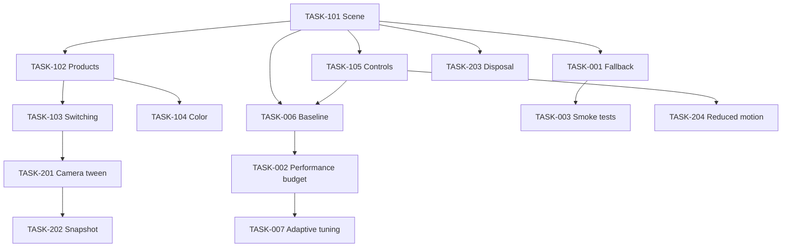

# Task Dependencies

## Dependency graph

## Critical sequence

`TASK-101 -> TASK-102 -> TASK-103 -> TASK-201 -> TASK-202`

## Independent eligible tasks

`TASK-001`, `TASK-004`, and `TASK-205` can begin without an unfinished blocking dependency. `TASK-006` is eligible because TASK-101 and TASK-105 are DONE.

## Circular dependency check

No circular dependencies found in the current graph.
